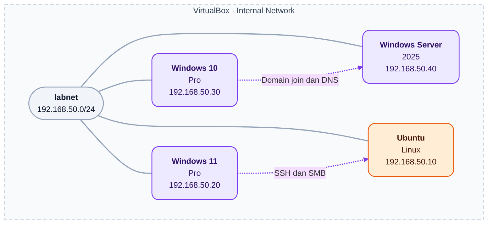

# Infrastructure Home Lab — Command Reference

Referensi perintah untuk konfigurasi, pemeriksaan, dan administrasi lingkungan home lab. Jalankan perintah sesuai kebutuhan, bukan sebagai satu skrip.

## Lab Topology

Keempat VM terhubung melalui VirtualBox Internal Network `labnet`
pada subnet `192.168.50.0/24`.

# Topologi Lab VirtualBox · labnet



**Legenda:** ungu = Windows · oranye = Linux · abu-abu = jaringan · garis putus-putus = hubungan layanan

**Keterangan:**
- Garis penuh menunjukkan koneksi ke jaringan internal; garis putus-putus menunjukkan contoh arah akses layanan.
- Ubuntu menyediakan SSH dan Samba share `labshare`.
- Windows Server menjadi Domain Controller `SRV-DC01` dan DNS Server untuk `corp.lab.test`.
- Adapter 1 menggunakan NAT untuk akses internet; jalur NAT tidak ditampilkan.
- Adapter NAT Windows 10 dinonaktifkan selama pengujian domain join untuk menghindari gangguan pemilihan DNS.

## Lab Environment

| Sistem | IP Internal | Fungsi |
|---|---|---|
| Ubuntu Linux | `192.168.50.10` | Linux Administration, SSH & Samba |
| Windows 11 Pro | `192.168.50.20` | Network Client |
| Windows 10 Pro | `192.168.50.30` | Domain Client |
| Windows Server 2025 | `192.168.50.40` | Domain Controller & DNS |

- **VirtualBox:** Adapter 1 — NAT; Adapter 2 — Internal Network (`labnet`).
- **Interface Ubuntu:** `enp0s3` — NAT; `enp0s8` — jaringan internal.
- **Active Directory:** domain `corp.lab.test`, NetBIOS `CORP`, DC `SRV-DC01`.
- **Samba share:** `/srv/samba/labshare`, diakses melalui `\\192.168.50.10\labshare`.

## 1. Networking

### Ubuntu — Bash

| Perintah | Fungsi |
|---|---|
| `ip -br addr` | Menampilkan ringkasan interface, status, dan alamat IP. |
| `ip route` | Memeriksa tabel routing dan default gateway. |
| `ping -c 4 192.168.50.40` | Menguji konektivitas ICMP ke Windows Server dengan empat paket. |
| `ping -c 4 1.1.1.1` | Menguji konektivitas ICMP ke alamat IP internet. |
| `nmcli device status` | Memeriksa status perangkat menurut NetworkManager. |
| `nmcli connection show` | Menampilkan profil koneksi NetworkManager. |

### Windows — Command Prompt

| Perintah | Fungsi |
|---|---|
| `ipconfig /all` | Memeriksa konfigurasi IP, gateway, DNS, dan DHCP. |
| `ping 192.168.50.10` | Menguji konektivitas ICMP ke Ubuntu. |
| `ping 192.168.50.40` | Menguji konektivitas ICMP ke Domain Controller. |
| `tracert 192.168.50.40` | Menelusuri jalur jaringan menuju Domain Controller. |

**Catatan:** Internal Network tidak menyediakan internet secara otomatis. Ping gagal dapat disebabkan oleh pemblokiran ICMP; ping berhasil belum membuktikan layanan SSH atau SMB dapat diakses.

## 2. SSH Remote Administration

### Ubuntu — Bash

```bash
sudo systemctl status ssh
```

Memeriksa status layanan OpenSSH Server.

```bash
sudo ss -tulnp
```

Memeriksa socket TCP yang listening dan socket UDP yang aktif, beserta proses terkait. SSH biasanya menggunakan TCP `22`.

```bash
sudo journalctl -u ssh -n 30 --no-pager
```

Menampilkan hingga 30 entri log terbaru layanan SSH.

### Windows — PowerShell

```powershell
ssh vboxuser@192.168.50.10
```

Mengakses Ubuntu sebagai `vboxuser`. Memerlukan OpenSSH Client pada Windows dan SSH Server pada Ubuntu.

**Urutan pemeriksaan jika gagal:** alamat tujuan → konektivitas jaringan → layanan SSH → port → firewall → log.

## 3. Linux Administration

| Perintah | Fungsi |
|---|---|
| `pwd` | Menampilkan direktori kerja saat ini. |
| `ls -lah` | Menampilkan isi direktori, termasuk file tersembunyi, permission, pemilik, dan ukuran. |
| `systemctl --failed` | Menampilkan unit systemd yang berstatus gagal. |
| `sudo journalctl -p err -n 30 --no-pager` | Menampilkan hingga 30 entri log terbaru dengan prioritas error atau lebih kritis. |

Pemeriksaan layanan SSH dan Samba dijelaskan pada bagian masing-masing.

## 4. File Permissions & ACL

Folder latihan: `/srv/permission-lab`.

### Memeriksa permission dan identitas

```bash
ls -ld /srv/permission-lab
getfacl /srv/permission-lab
id labread
```

- `ls -ld`: memeriksa permission, pemilik, dan grup direktori itu sendiri.
- `getfacl`: memeriksa ACL, termasuk mask yang dapat membatasi izin efektif.
- `id`: memeriksa identitas dan keanggotaan grup pengguna.

### Contoh perubahan permission

```bash
chmod 750 /srv/permission-lab
```

Mengatur izin direktori menjadi:

| Kategori | Izin | Arti pada direktori |
|---|---|---|
| Owner | `rwx` | Membaca daftar isi, mengubah entri, dan masuk direktori. |
| Group | `r-x` | Membaca daftar isi dan masuk direktori. |
| Other | `---` | Tidak mendapat izin dari mode dasar ini. |

```bash
sudo setfacl -m u:labread:r-x /srv/permission-lab
```

Memberikan entri ACL baca dan masuk direktori kepada `labread`. Akun tersebut harus sudah tersedia.

**Catatan:** Contoh perubahan di atas bukan rekaman aturan akhir lab. Perintah tidak berlaku rekursif dan tidak mengatur pewarisan ACL. Akses juga dipengaruhi permission direktori induk serta ACL yang sudah ada.

## 5. Samba File Sharing

### Ubuntu — Bash

| Perintah | Fungsi |
|---|---|
| `sudo systemctl status smbd` | Memeriksa status layanan Samba. |
| `sudo nano /etc/samba/smb.conf` | Mengedit konfigurasi Samba. |
| `sudo testparm` | Memeriksa validitas konfigurasi Samba. |
| `sudo systemctl restart smbd` | Memulai ulang Samba setelah perubahan konfigurasi. |
| `sudo smbstatus` | Memeriksa sesi, koneksi share, dan informasi lock. |
| `ls -ld /srv/samba/labshare` | Memeriksa permission direktori share. |
| `getfacl /srv/samba/labshare` | Memeriksa ACL direktori share. |
| `sudo journalctl -u smbd -n 30 --no-pager` | Memeriksa log terbaru layanan Samba. |

### Windows — File Explorer

Masukkan alamat berikut pada address bar:

```text
\\192.168.50.10\labshare
```

**Urutan setelah mengedit konfigurasi:** `testparm` → perbaiki jika ada kesalahan → restart → uji akses dari Windows.

**Catatan:** Hak akses melalui Samba dipengaruhi konfigurasi share serta permission dan ACL Linux. Restart dapat memutus sesi aktif.

## 6. Firewall — UFW

### Memeriksa status dan aturan

```bash
sudo ufw status numbered
sudo ufw status verbose
```

Menampilkan status, aturan, dan detail kebijakan firewall.

### Mengizinkan SSH dan SMB dari jaringan internal

```bash
sudo ufw allow in on enp0s8 from 192.168.50.0/24 to any port 22 proto tcp
sudo ufw allow in on enp0s8 from 192.168.50.0/24 to any port 445 proto tcp
```

| Port | Layanan |
|---|---|
| TCP `22` | SSH |
| TCP `445` | SMB langsung |

### Mengaktifkan UFW

```bash
sudo ufw enable
```

**Catatan:** Pastikan aturan SSH sesuai sebelum mengaktifkan UFW melalui sesi SSH. Menambahkan aturan tidak otomatis mengaktifkan firewall atau menghapus aturan lain yang lebih luas.

## 7. DNS & DHCP

### Ubuntu — Bash

| Perintah | Fungsi |
|---|---|
| `resolvectl status` | Memeriksa konfigurasi DNS pada systemd-resolved. |
| `dig corp.lab.test` | Melakukan query record A melalui resolver yang digunakan oleh dig. |
| `dig @192.168.50.40 corp.lab.test` | Menguji query record A langsung ke DNS Server lab. |

### Windows — Command Prompt

```cmd
ipconfig /all
```

Memeriksa DNS yang dikonfigurasi, status DHCP, serta informasi sewa jika adapter menggunakan DHCP.

```cmd
nslookup corp.lab.test
```

Menguji resolusi domain melalui DNS default yang digunakan oleh `nslookup`.

```cmd
nslookup corp.lab.test 192.168.50.40
```

Menguji resolusi domain langsung melalui DNS Server lab.

```cmd
nslookup -type=SRV _ldap._tcp.dc._msdcs.corp.lab.test 192.168.50.40
```

Memeriksa record SRV LDAP untuk penemuan Domain Controller.

**Catatan lab:** Adapter NAT Windows 10 dinonaktifkan selama pengujian domain join karena konfigurasi DNS-nya sempat mengganggu pencarian domain. Client menggunakan DNS internal `192.168.50.40`.

**Catatan diagnosis:** Query langsung ke DNS Server dapat berhasil meskipun DNS default client masih salah.

## 8. Windows Server & Active Directory

### Windows Server — PowerShell

```powershell
Get-ADDomain
```

Menampilkan informasi domain Active Directory.

```powershell
Get-Service NTDS,DNS,Netlogon
```

Memeriksa status layanan AD DS, DNS Server, dan Netlogon.

```powershell
Get-ADUser -Identity labuser
```

Memeriksa properti dasar akun domain `labuser`.

### Windows Server — Command Prompt

```cmd
net share
```

Memeriksa share lokal, termasuk keberadaan `SYSVOL` dan `NETLOGON` pada Domain Controller.

### Windows Client — Command Prompt

| Perintah | Fungsi |
|---|---|
| `sysdm.cpl` | Membuka System Properties untuk pengaturan domain join. |
| `systeminfo \| findstr /B /C:"Domain"` | Memeriksa baris domain atau workgroup komputer. |
| `whoami` | Memeriksa identitas pengguna pada sesi saat ini. |

Contoh identitas setelah login sebagai pengguna domain:

```text
corp\labuser
```

### Administrative Tools — Run

| Perintah | Fungsi |
|---|---|
| `dsa.msc` | Membuka Active Directory Users and Computers. |
| `dnsmgmt.msc` | Membuka DNS Manager. |

**Catatan:** Cmdlet AD memerlukan modul `ActiveDirectory`; konsol administrasi memerlukan tools terkait. Filter `Domain` pada `systeminfo` bergantung pada bahasa Windows. Komputer yang sudah bergabung ke domain tetap dapat digunakan untuk login dengan akun lokal.

## 9. Backup & Restore

### Ubuntu — Bash

```bash
tar -czvf backup.tar.gz nama-folder
```

Membuat arsip gzip. Jalankan dari direktori induk agar arsip berada di luar folder sumber.

```bash
tar -tzf backup.tar.gz
```

Memeriksa daftar isi arsip tanpa mengekstraknya.

```bash
mkdir -p direktori-tujuan
tar -xzvf backup.tar.gz -C direktori-tujuan
```

Menyiapkan direktori tujuan dan mengekstrak arsip. File dengan path yang sama dapat tertimpa.

```bash
diff file-asli file-restore
sha256sum file-asli file-restore
```

Membandingkan isi file dan menampilkan checksum untuk verifikasi hasil restore.

**Catatan:** Checksum memverifikasi isi file, bukan permission atau kepemilikan. Contoh arsip ini belum secara eksplisit menyertakan ACL dan extended attributes.

## Catatan Penggunaan

- Sesuaikan IP, interface, akun, dan path dengan sistem yang digunakan.
- `nama-folder`, `direktori-tujuan`, `file-asli`, dan `file-restore` adalah placeholder.
- `nmcli` memerlukan NetworkManager; `resolvectl` memerlukan systemd-resolved.
- Beberapa perintah memerlukan paket tambahan atau hak administrator.
- Contoh perintah dan output merupakan referensi; hasil praktik aktual dicatat pada dokumentasi pengujian lab.
